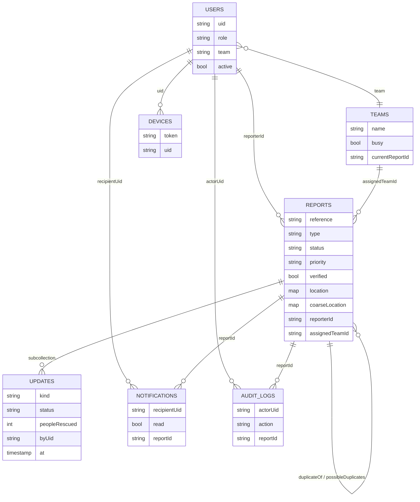

# Database schema (Firestore)

Status: written from `X-SPEC.md` section 4, checked against the code at commit f7c5b96. Where the code differs from the spec, the difference is listed in section 8. Items marked UNVERIFIED were not confirmed by reading the code or running the emulator.

Database: Cloud Firestore (Native mode), one Firebase project. Rules and indexes live in `firebase/firestore.rules` and `firebase/firestore.indexes.json`.

## 1. Who writes and who reads

- The Express API (Firebase Admin SDK) is the only writer. It verifies the Firebase ID token, checks the role, runs the status workflow, writes `auditLogs`, and sends notifications.
- Web and Flutter clients read live through Firestore listeners. Security rules limit each read by role (section 6).
- Clients never write report data. Every client write rule is `false`.

## 2. Collections

Timestamps are Firestore Timestamps. "Enum" lists the allowed values the API enforces.

### `users/{uid}`

| Field | Type | Notes |
|---|---|---|
| name | string | |
| role | enum | `resident`, `dispatcher`, `responder`, `dmo`, `admin` (see section 8) |
| phone | string | Format checked by the API (PHONE_RE) |
| team | string or absent | Team id, responders only. Also copied to the `team` custom claim |
| active | boolean | `false` for disabled accounts. Claims keep `active: false` |
| createdAt | timestamp | |

Role and active state are also custom claims on the Firebase Auth user: `{role, active, team?}`.

### `reports/{reportId}`

| Field | Type | Notes |
|---|---|---|
| reference | string | Human reference ID shown on the success screen |
| type | enum | `flood`, `fire`, `earthquake`, `landslide`, `other` |
| description | string | 3 to 1000 characters after sanitizing |
| status | enum | See section 4 |
| verified | boolean | Set to `true` by the verify action |
| priority | enum | `low`, `medium`, `high`, `critical`. New reports start at `medium` |
| classification | string | Free text, 1 to 100 characters, set by the dispatcher |
| location | map | `{lat, lng, source}`, `source` is `gps` or `manual`. Exact. Restricted by role |
| coarseLocation | map | `{lat, lng}` snapped to a grid of 0.005 degrees (about 500 m). Used for public views |
| addressText | string or absent | Up to 300 characters |
| reporterId | string | Firebase uid of the resident |
| contact | map or absent | `{name, phone}`, name up to 100 characters |
| photos | array of map | Each `{url, sizeBytes, mimeType}`. Up to 5. `url` is the Cloudinary URL |
| assignedTeamId | string or absent | Set on assignment |
| duplicateOf | string or absent | Report id, set by the dispatcher's duplicate action |
| possibleDuplicates | array of string | Open reports of the same type within 200 m and 6 hours, flagged for review. The new report is still saved |
| rejectionReason | string or absent | Required when status is `Rejected` |
| createdAt | timestamp | |
| updatedAt | timestamp | |

### `reports/{reportId}/updates/{updateId}`

Append-only history of a report. One document is written for each transition, and for each responder acknowledgement.

| Field | Type | Notes |
|---|---|---|
| kind | string | `status` or `acknowledge` (written by the code, not in the spec) |
| status | string or absent | Present on `status` entries |
| note | string | Up to 1000 characters, sanitized. Empty string when none |
| peopleRescued | integer | 0 to 10000. Default 0 |
| byUid | string | Uid of the actor |
| at | timestamp | Ordered ascending when read |

### `teams/{teamId}`

| Field | Type | Notes |
|---|---|---|
| name | string | Up to 100 characters |
| members | array of string | Spec field. Code derives members from `users.team` (UNVERIFIED whether this array is written) |
| busy | boolean | Set to `true` on assignment, `false` on close |
| currentReportId | string or null | The rescue the team is on |

The spec lists `status` (available, busy, offline). The code uses `busy` and `currentReportId` instead (section 8).

### `notifications/{notifId}`

| Field | Type | Notes |
|---|---|---|
| recipientUid | string | |
| title | string | |
| body | string | |
| reportId | string | |
| read | boolean | Set to `true` by `PATCH /notifications/:id/read` |
| createdAt | timestamp | Stored before the push is sent |

### `auditLogs/{logId}`

| Field | Type | Notes |
|---|---|---|
| actorUid | string | |
| action | string | Examples in code: `report.create`, `report.verify`, `report.reject`, `report.close`, `report.acknowledge`, `priority.change` |
| reportId | string or absent | |
| before | map or absent | Plain values only |
| after | map or absent | Plain values only |
| at | timestamp | |

Append-only: rules deny all client writes, and the API only adds documents.

### `config/hotlines`

| Field | Type | Notes |
|---|---|---|
| numbers | array of map | Each entry holds a label and a number. Shown in the apps. The seed uses a placeholder number |

The spec says dispatchers can edit this document. No API route for it was found (section 8).

### `devices/{token}` (not in the spec)

| Field | Type | Notes |
|---|---|---|
| uid | string | Owner of the FCM token |
| createdAt | timestamp | |

Used to send push notifications. Rules deny all client access. The API adds the token on `POST /devices` and removes it on `DELETE /devices/:token` or when FCM reports the token as dead.

## 3. Entity relationships



## 4. Status workflow

```
Submitted -> Under Verification -> Verified -> Awaiting Assignment
  -> Team Assigned -> Rescue in Progress -> Resolved -> Closed
Side exits: Rejected (from Submitted or Under Verification, reason required),
            Duplicate (from Submitted or Under Verification, sets duplicateOf),
            Cancelled (reporter, Submitted only)
```

The API checks every edge in `api/src/domain/workflow.js`. Any other transition returns HTTP 409. A wrong role for an edge returns HTTP 403.

| From | To | Role |
|---|---|---|
| Submitted | Under Verification | dispatcher |
| Submitted | Rejected, Duplicate | dispatcher |
| Submitted | Cancelled | resident |
| Under Verification | Verified, Rejected, Duplicate | dispatcher |
| Verified | Awaiting Assignment | dispatcher |
| Awaiting Assignment | Team Assigned | dispatcher |
| Team Assigned | Rescue in Progress | responder |
| Rescue in Progress | Resolved | responder |
| Resolved | Closed | dispatcher |

Closed, Rejected, Duplicate, and Cancelled are closed states (`isOpen` in the same file). Cancel is allowed only from Submitted, as the spec says.

## 5. Indexes

From `firebase/firestore.indexes.json`, all collection scope:

| Collection | Fields | Used for |
|---|---|---|
| reports | reporterId ASC, createdAt DESC | My Reports (resident) |
| reports | assignedTeamId ASC, createdAt DESC | Responder assignments |
| reports | status ASC, createdAt DESC | Queue filtered by status |
| reports | type ASC, createdAt DESC | Statistics by type |
| auditLogs | actorUid ASC, at DESC | Audit filter by actor |
| auditLogs | reportId ASC, at DESC | Audit filter by report |
| auditLogs | action ASC, at DESC | Audit filter by action |
| notifications | recipientUid ASC, createdAt DESC | Notification list |

The spec planned `assignedTeamId + status` for the responder query. The file has `assignedTeamId + createdAt` instead (section 8). Map queries use a bounding box on `location.lat` and `location.lng`. No composite index was added for that, so it relies on single-field indexes (UNVERIFIED that the map query works without a run on the emulator or real project).

## 6. Security rules (summary)

Rules are the second layer. The API is the first. A token whose `active` claim is not `true` reads nothing.

| Collection | Read | Write |
|---|---|---|
| reports | dispatcher and dmo: all. resident: own reports (`reporterId`). responder: reports assigned to the team claim | none |
| reports/updates | same rule as the parent report | none |
| users/{uid} | the user themself, or dispatcher | none |
| notifications | `recipientUid` equals the user | none |
| teams | dispatcher, dmo, responder | none |
| auditLogs | dispatcher and dmo | none (API appends) |
| config/hotlines | any active user | none |
| devices | none | none |
| anything else | none | none |

Note: the rules let responders read the `teams` collection. The API's `GET /api/teams` does not (dispatcher, dmo, admin only). The client should use the API for teams (UNVERIFIED which path the web app uses).

The rules are tested in `firebase/rules.test.js` on the Firebase emulator. The API suite is in `api/test`. Neither was run for this document.

## 7. Privacy rules in data form

- Exact `location` is read only by dispatcher, dmo, the reporter, and the assigned responder.
- Public views use `coarseLocation`. The API's projection (`api/src/domain/privacy.js`) returns only `id, type, status, priority, coarseLocation, createdAt` to users who are not staff, not the reporter, and not the assigned team, and only for statuses Verified, Awaiting Assignment, Team Assigned, Rescue in Progress, and Resolved.
- Contact details are not part of CSV exports.

## 8. Why Firestore (and differences from the spec)

**Decision.** The brief suggested PostgreSQL with PostGIS or MySQL. The team chose Firestore. The spec (section 2) records the reason as: the brief allows stack choice based on team skills. The spec does not record further reasons.

**What the spec gives as the uses for Firestore.** Firebase Auth (roles as custom claims), Firestore for data, and FCM for push. Both clients use Firestore listeners for live updates, and the API does all writes.

Reasons still to confirm with the team before submission: UNVERIFIED. Do not add reasons here until the team agrees on them.

**Differences between the spec and the code (as of f7c5b96):**

1. `admin` role. The spec has four roles, and says admin and dispatcher are one role. The API has an `admin` role on several routes (`/api/teams`, `/api/users` read, `/api/audit`, `/api/stats`). Firestore rules do not know `admin`, so an admin cannot read through listeners.
2. Team status. The spec has `status` (available, busy, offline). The code has `busy` and `currentReportId`.
3. Responder index. The spec has `assignedTeamId + status`. The file has `assignedTeamId + createdAt`.
4. Extra collections and fields not in the spec: `devices`, `updates.kind`, `reports.reference`, `reports.rejectionReason`, `teams.currentReportId`.
5. Hotline editing. The spec says dispatchers can edit `config/hotlines`. No route was found in `api/src/routes`, so the document is read-only in practice (UNVERIFIED that no route exists elsewhere).
6. Rules and API disagree on team reads (section 6).
