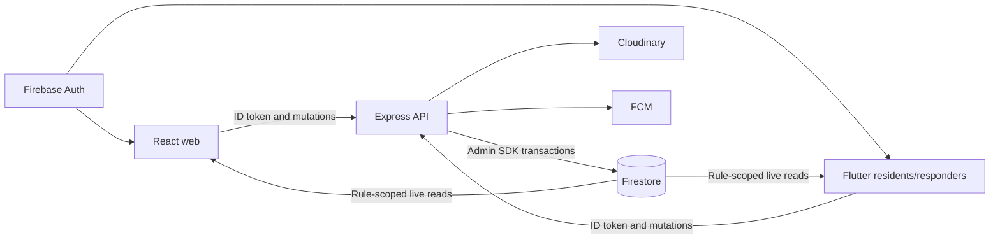
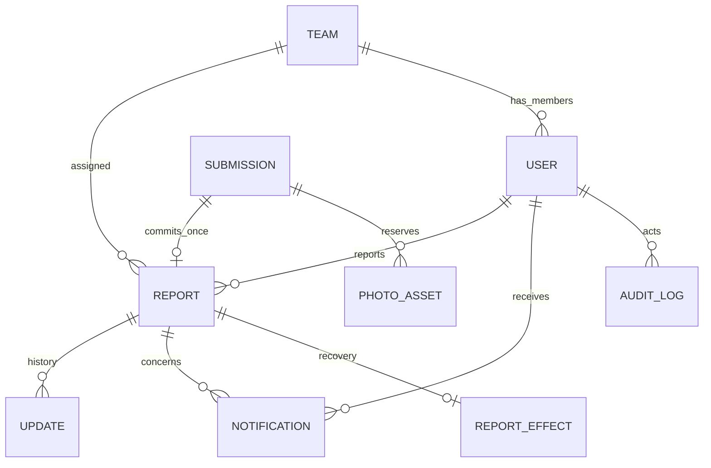
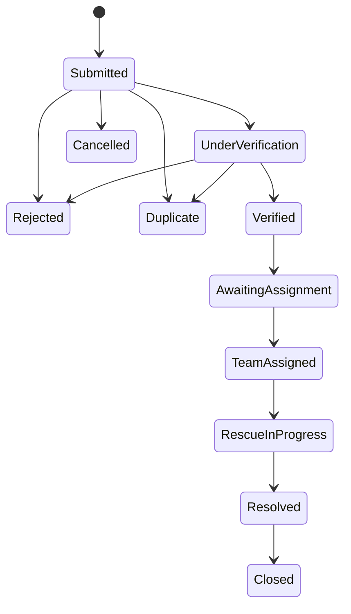

# Firestore database schema and access

Current source summary, 20 October 2026. Supersedes the earlier f7c5b96-era description. Source authorities: firebase/firestore.rules, firebase/firestore.indexes.json, api/src/adapters/firestoreRepo.js, api/src/services/reportService.js and api/src/domain/workflow.js. This is a document schema, not SQL DDL. Field validation remains defined by the API validators; this guide describes persisted domain relationships and access.

## Architecture

Operational database writes go through the API. Firestore rules deny all direct client writes. Auth account creation/sign-in uses Firebase Auth; this is separate from operational Firestore writes. Provider delivery is not guaranteed merely because a database transaction committed.

## Collections

| Path | Key data and relationships | Client reads |
|---|---|---|
| users/{uid} | name, role, phone, team, active, createdAt; provisioning/claims-sync fields where present | Active owner, dispatcher or admin |
| reports/{id} | reference, type, description, status, verified, priority, exact location, coarseLocation, reporterId, photos, createdAt/updatedAt; optional addressText/contact, assignedTeamId, classification, duplicateOf, possibleDuplicates and rejectionReason | Staff (dispatcher, DMO, admin), owning resident, current assigned responder team |
| reports/{id}/updates/{id} | kind, status, note, peopleRescued, byUid, at; acknowledgement/status history | Same authorization as parent report |
| teams/{id} | name, busy, currentReportId; user.team links members | Dispatcher, DMO, admin; responder's own team |
| notifications/{id} | recipientUid, title, body, reportId, read, createdAt | Active recipient only |
| auditLogs/{id} | actorUid, action, reportId where relevant, before/after, at | Dispatcher and admin |
| config/hotlines | numbers list with labels/numbers and configuration metadata | Active accounts |
| config/demo | Synthetic-workspace indicator written by seed tooling | Active accounts |
| devices/{token} | uid, createdAt; server-owned push registration | None; API only |
| submissions/{hash} | Exact account/key claim identity, payload fingerprint, lease/generation, reserved report id/reference, completion result | None; API only |
| photoAssets/{hash} | Reserved asset identity, owning attempt/generation, cleanup state, retry timing | None; API only |
| reportEffects/{reportId} | Durable post-create audit/notification recovery work | None; API only |
| mutationEffects/{id} | Durable post-mutation recovery work and retry timing | None; API only |

Server-only collections are protected by explicit denies or the catch-all deny. Legacy submission IDs are read only with ownership checks. Asset IDs and provider credentials are not public report metadata.

## Relationships

IDs are references, not relational foreign-key constraints. The API and Firestore transactions enforce workflow and ownership. Timestamps are Firestore timestamps on reads. Report photos contain public URL, size and MIME metadata; cleanup identities remain server-only.

## Identity and privacy

Current profile data and token claims must agree on role/team. Active profile state is required; stale token claims alone do not authorize a moved or deactivated responder. Clients also hold protected views during synchronization. An offline client cannot learn a remote change instantly.

Exact report data is restricted to authorized readers. coarseLocation supports approximate displays; it does not make the reports collection anonymously readable. Admin has current staff Firestore access and a web workspace. The old claim that admin was API-only with no rule access is obsolete.

## Workflow

The diagram abbreviates labels containing spaces. Dispatcher permissions govern review/assignment/closure; resident cancellation is only from Submitted; responder permissions govern assigned rescue progress. Admin inherits staff grants through the API permission helper. The domain workflow file is authoritative for individual transitions and 409 refusal behavior.

## Bounded reads and recovery

Native progress history reads the newest 20 at a time, initially discloses five, then offers more/older. Recently closed is bounded to ten team reports. Staff/API list/export paths have their own limits; do not describe every query as unbounded.

Report creation commits its claim/report together; retries bind a key to validated content. Responder update attempts use fixed identities. Claim ownership and current permissions are checked before replay. Photo reconciliation keeps unresolved rows rather than automatically forgetting assets. These mechanisms do not replace real Cloudinary, hosted rules/index and crash testing.

## Deployment and policy

Deploy the checked-in indexes and rules only to the explicitly authorized project. Hosted index readiness is a separate check from local emulator tests. Owner-approved retention/deletion policy, hotline/authority and privacy wording remain required; this schema does not establish those policies. Backups must exclude credentials and real resident data from submission material.
